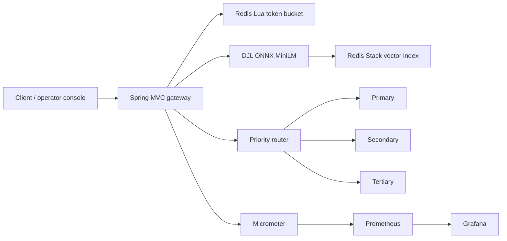

# STRATA / ResilientLLM Gateway

An OpenAI-compatible gateway that routes requests across ordered LLM providers. It uses Resilience4j circuit breakers, bounded retries, per-key Redis token buckets, a local MiniLM embedding model with Redis vector search, and live metrics. A built-in operator console provides traffic, provider, cache, and chaos controls.

The console bundles Chakra Petch and IBM Plex Mono locally, with their license files in `src/main/resources/static/fonts`, so the visual design does not depend on a font CDN.

## Start

Requirements: Docker Engine with Compose. The first build downloads Maven dependencies and the 90 MB ONNX MiniLM model.

```sh
docker compose up --build
```

Open the [operator console](http://localhost:8080), [Grafana](http://localhost:3000), or [Prometheus](http://localhost:9090). The local admin token and Grafana password default to `local-dev-only`. Set `ADMIN_TOKEN` and `GRAFANA_PASSWORD` in a local `.env` for any shared environment. Mock providers and Redis are reachable only from localhost and the Compose network.

The gateway accepts any nonempty Bearer key in this reproducible mock setup. Add authentication at your ingress, or an allowlist, before exposing it publicly. The admin API is token protected. The mock outage endpoints are test controls and must remain private.

```sh
curl -sS http://localhost:8080/v1/chat/completions \
  -H 'Content-Type: application/json' \
  -H 'Authorization: Bearer demo-key' \
  -d '{"model":"mock-1","temperature":0,"messages":[{"role":"user","content":"Explain circuit breakers briefly."}]}'
```

The response includes `X-Request-Id`, `X-Provider`, and `X-Cache`. Streaming requests return 400 because streaming is outside this version's scope. Other OpenAI chat fields are passed to the selected provider unchanged, except `model`, which maps to each provider's configured model.

## Architecture



Each provider has a circuit breaker, a two-attempt jittered retry, a time limiter, and a local Resilience4j rate limiter. The Redis Lua token bucket provides the per-API-key cross-instance limit. The router skips OPEN circuits and tries the next provider. Calls use HTTP connect/read timeouts and a bounded executor.

The cache embeds the full `messages` array, searches a 384-dimensional HNSW index, and accepts a result at cosine similarity `0.92` or higher by default. Its namespace includes a SHA-256 hash of the API key, requested model, and temperature. This prevents cross-key reuse. Cache entries expire after one hour. Requests above temperature `0.3`, requests without an explicit low temperature, and requests with `X-Cache-Bypass: true` skip caching. A sampled, prompt-hash-only audit is available at `GET /admin/cache/audit`. Semantic matches can still be false positives, so use bypass for high-stakes or rapidly changing answers.

## API and operations

| Endpoint | Purpose |
| --- | --- |
| `POST /v1/chat/completions` | OpenAI-compatible nonstreaming chat completion |
| `GET /admin/status` | Live telemetry, provider circuits, cache state |
| `GET /admin/cache/audit` | Sampled cache decisions with hashed prompts |
| `POST /admin/providers/{id}/state` | Toggle a mock provider for chaos testing |
| `GET /actuator/prometheus` | Prometheus scrape endpoint |
| `GET /actuator/health` | Health endpoint |

Admin endpoints require `X-Admin-Token`. Mock services also expose `/admin/state` on localhost ports 8081, 8082, and 8083. Use the gateway admin endpoint when possible.

To use real providers, set each provider's `TYPE`, `URL`, `MODEL`, and `API_KEY` environment variables. `groq`, `openai`, and `compatible` types use the OpenAI chat completion wire format. For example, `PRIMARY_TYPE=groq`, `PRIMARY_URL=https://api.groq.com/openai`, `PRIMARY_MODEL=<groq-model>`, and `PRIMARY_API_KEY=<key>` configure Groq. The second provider can use any OpenAI-compatible endpoint. No real provider key is needed for the mock stack.

| Setting | Default | Meaning |
| --- | --- | --- |
| `PORT` | `8080` | HTTP listen port |
| `ADMIN_TOKEN` | `local-dev-only` | Admin endpoint token |
| `REDIS_HOST`, `REDIS_PORT` | `localhost`, `6379` | Redis Stack connection |
| `RATE_LIMIT_CAPACITY` | `2000` | Maximum tokens per API key |
| `RATE_LIMIT_REFILL_PER_SECOND` | `500` | Token refill rate |
| `CACHE_ENABLED` | `true` | Enable semantic cache |
| `CACHE_THRESHOLD` | `0.92` | Minimum cosine similarity |
| `EMBEDDING_MODEL_PATH` | `/opt/models/all-MiniLM-L6-v2` | Local model directory |
| `PRIMARY_TYPE`, `SECONDARY_TYPE`, `TERTIARY_TYPE` | `mock` | Provider implementation |
| `PRIMARY_URL`, `SECONDARY_URL`, `TERTIARY_URL` | Local mock ports | Provider API base URL |
| `PRIMARY_MODEL`, `SECONDARY_MODEL`, `TERTIARY_MODEL` | `mock-1` | Model sent to provider |
| `PRIMARY_API_KEY`, `SECONDARY_API_KEY`, `TERTIARY_API_KEY` | Empty | Upstream Bearer tokens |
| `MOCK_LATENCY_MS`, `MOCK_ERROR_RATE` | `80`, `0` | Mock latency and failure injection |

Request timeout is 3 seconds, slow-call threshold is 1.4 seconds, circuit failure threshold is 50% over a 10-call window with at least 5 calls, and OPEN recovery wait is 12 seconds. These values, cache TTL, temperature limit, and audit sampling are in `src/main/resources/application.yml`.

## Tests and benchmarks

With Java 17 available, run:

```sh
./mvnw verify
./mvnw -q spotless:check
```

The test suite covers router failover and circuit transitions, cache bypass and hit behavior, Redis token bucket concurrency, and vector cache namespace isolation. Testcontainers tests run when Docker is available.

With the stack running, use `k6 run bench/load.js` for a five minute 30 requests per second run, then `k6 run bench/chaos.js`. The chaos script sends uncached requests while disabling primary and secondary at 30 and 60 seconds. Both are restored in teardown. See [bench/RESULTS.md](bench/RESULTS.md) for dataset details and measured values once the full environment is available. The supplied Grafana dashboard provisions panels for throughput, p50/p95/p99 latency, error rate, cache hit rate, circuit state, and provider call and failover rates.

## Limits

- Streaming responses are not implemented.
- The in-process recent-event display resets on restart and is scoped to one gateway replica. Prometheus counters also restart, while rate limits and cache entries live in Redis.
- Cache inference requires the local ONNX model. If model loading fails, requests still route to providers and the cache reports unavailable.
- The gateway returns 503 if Redis cannot enforce the per-key rate limit. This deliberately avoids unbounded traffic when the limiter is down.
- Provider client 4xx errors currently count toward circuit failures. Add request-error classification before using providers with strict validation.
- This checkout was compiled and unit tested on the provided machine, but Docker and k6 were unavailable, so the Compose stack, Grafana screenshot, Testcontainers integration, and benchmark claims remain unverified here. No performance numbers are claimed.
